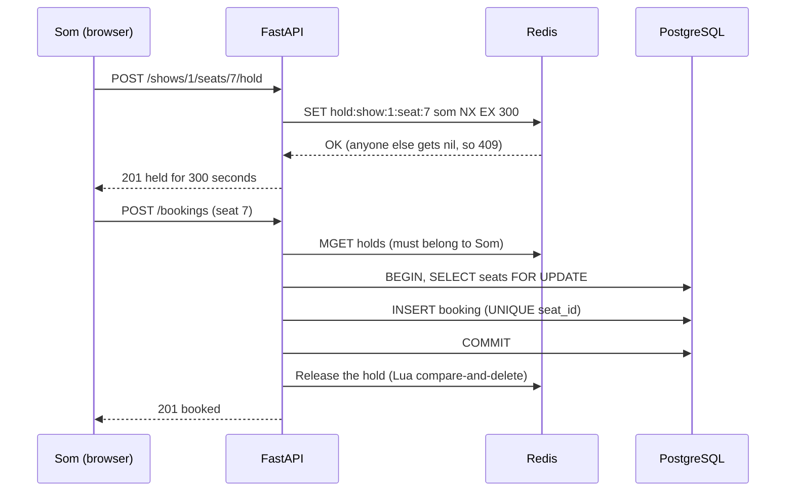
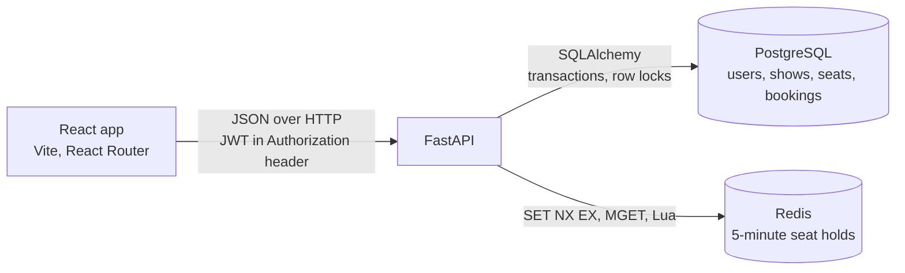

# Bookify

**A movie, bus and event booking site for Bengaluru where two people can never book the same seat.**

Pick a show, tap your seats, and they're held for you for 5 minutes while you pay. If someone else taps the same seat a moment later, they see it's taken. Under the hood, three independent safety layers make double-booking impossible, and automated tests prove it by sending 20 simultaneous requests for one seat.

Built with **FastAPI**, **PostgreSQL**, **Redis** and **React**.

<!--
## Screenshots
To show screenshots here, add images to docs/screenshots/ and delete these comment lines.

| Home | Seat map: two users, one seat |
|---|---|
|  |  |
| **Checkout** | **Your ticket** |
|  |  |
-->

---

## Features

**Browse**
- Home page with featured slides, category shortcuts and scrollable rows of movies, events and bus routes
- Movies, Events and Buses pages with language and genre filters and sorting (filters live in the URL, so links are shareable)
- Search across titles, genres, languages and venues
- Title pages with details, date tabs and showtimes grouped by venue, plus "filling fast" hints

**Book**
- Live seat map grouped by price, refreshed every 5 seconds, showing seats that are available, held by you, held by someone else or sold
- Seats are held for **5 minutes** with a visible countdown; holds survive a page refresh and release themselves if you don't pay
- Checkout with an order summary and a demo payment step
- All-or-nothing booking: book several seats at once, or none of them
- Booking confirmation ticket with a reference number

**Account**
- Sign up and sign in with JWT authentication (passwords hashed with Argon2)
- Browse freely; sign-in is only needed to pick seats, and you return to the same page afterwards
- My tickets (upcoming and past) and a profile page

---

## How double-booking is prevented

Three independent layers. Each one would stop a double booking on its own; together, they make it impossible.

| Layer | Where | What it does |
|---|---|---|
| 1. Seat hold | Redis | `SET key user NX EX 300` holds a seat for 5 minutes. `NX` means "only if nobody holds it", and Redis does the check and the write in one atomic step, so when two people tap the same seat at the same instant, exactly one wins. |
| 2. Row lock | PostgreSQL | Booking runs in a transaction that locks the seat rows with `SELECT ... FOR UPDATE`. Anyone else booking those seats waits until the first transaction finishes, then sees they're taken. Locks are always taken in seat-id order, which prevents deadlocks. |
| 3. Unique constraint | PostgreSQL | `UNIQUE(seat_id)` on the bookings table. Even if layers 1 and 2 had a bug, the database refuses a second booking for the same seat. |

Releasing a hold uses a small Lua script that runs inside Redis, so you can only release a hold that is yours, even if it expires at the same moment.



### Proof: concurrency tests

`backend/tests/test_concurrency.py` starts 20 threads, lines them up at a barrier, and releases them at the same instant against the real PostgreSQL and Redis:

| Race | Result |
|---|---|
| 20 users hold the same seat | exactly 1 succeeds, 19 get `409` |
| 20 users book the same seat **with the Redis check switched off** | exactly 1 booking (row lock + unique constraint alone) |
| 20 users hold then book the same seat | exactly 1 booking |
| 20 users book 20 different seats | all 20 succeed (no false conflicts) |
| Half book seats A+B, half book B+A | 1 winner, no deadlock |

---

## Architecture



- **Temporary state** (seat holds) lives in Redis with a time-to-live, so abandoned holds clean themselves up.
- **Permanent state** (users, shows, seats, bookings) lives in PostgreSQL, protected by transactions and constraints.
- The frontend is never trusted for safety: the countdown is only a display, and every rule is enforced by the API.

### Tech stack

| Area | Tools |
|---|---|
| Backend | Python 3.12, FastAPI, SQLAlchemy 2, Alembic, Pydantic, pwdlib (Argon2), PyJWT |
| Data | PostgreSQL 17, Redis 7.4 (both in Docker Compose) |
| Frontend | React, Vite, React Router, plain CSS with design tokens |
| Testing | pytest (unit, database, API and concurrency tests), Oxlint, Vite production build |

---

## Running it locally

**You need:** Docker Desktop, Python 3.12, Node.js 22 or newer.

**1. Clone and configure**
```bash
git clone https://github.com/somsatyesh108/seat-booking-system.git
cd seat-booking-system
cp .env.example .env
```
Open `.env` and set `POSTGRES_PASSWORD` and `JWT_SECRET_KEY`. You can generate a strong secret with:
```bash
python3 -c "import secrets; print(secrets.token_urlsafe(48))"
```

**2. Start PostgreSQL and Redis**
```bash
docker compose up -d
docker compose ps        # both should show (healthy)
```

**3. Start the API** (in a new terminal)
```bash
cd backend
python3.12 -m venv .venv
source .venv/bin/activate
pip install -r requirements.txt
alembic upgrade head      # create the tables
python -m app.seed        # add the sample shows and seats
uvicorn app.main:app --reload
```
The API runs at http://127.0.0.1:8000, with interactive docs at http://127.0.0.1:8000/docs.

**4. Start the website** (in another terminal)
```bash
cd frontend
npm install
npm run dev
```
Open http://localhost:5173 and create an account. To see the hold protection in action, sign in as a second user in a private window and open the same showtime.

---

## API

| Method | Path | Sign-in | What it does |
|---|---|---|---|
| POST | `/auth/signup` | | Create an account |
| POST | `/auth/login` | | Get a JWT (OAuth2 password form) |
| GET | `/auth/me` | ✓ | The signed-in user |
| GET | `/shows?category=movie` | | Showtimes with seats left and lowest price |
| GET | `/shows/{show_id}` | | One showtime |
| GET | `/shows/{show_id}/seats` | | Seat map: available, held or booked |
| POST | `/shows/{show_id}/seats/{seat_id}/hold` | ✓ | Hold a seat for 5 minutes |
| DELETE | `/shows/{show_id}/seats/{seat_id}/hold` | ✓ | Release your own hold |
| POST | `/bookings` | ✓ | Book the seats you hold (all-or-nothing) |
| GET | `/bookings/me` | ✓ | Your bookings |
| GET | `/health` | | Status of the API, PostgreSQL and Redis |

---

## Tests

```bash
cd backend && pytest -v          # 60 tests
cd frontend && npm run lint && npm run build
```

| File | Tests | Covers |
|---|---|---|
| `test_security.py` | 9 | Password hashing, JWT signing, expiry, tampering and forgery |
| `test_models.py` | 6 | Database rules, including the double-booking guard |
| `test_auth.py` | 9 | Signup, login, duplicate emails, `/auth/me` |
| `test_holds.py` | 12 | Holds, conflicts, release rules, expiry, Redis outages |
| `test_bookings.py` | 9 | Holds required, all-or-nothing, the database layer on its own |
| `test_concurrency.py` | 5 | 20-user races against the real database and Redis |
| `test_show_listing.py` | 5 | Listing details, seats left, category filter |
| `test_health.py`, `test_cors.py` | 5 | Health checks and allowed origins |

Tests run against a rolled-back database transaction and a separate Redis database, so they never change real data.

---

## Project structure

```
seat-booking-system/
├── docker-compose.yml        PostgreSQL + Redis
├── .env.example              settings template (copy to .env)
├── backend/
│   ├── alembic/              database migrations
│   ├── app/
│   │   ├── main.py           FastAPI app, CORS, /health
│   │   ├── models.py         users, shows, seats, bookings
│   │   ├── holds.py          Redis seat holds (SET NX EX, Lua release)
│   │   ├── security.py       Argon2 hashing, JWT tokens
│   │   ├── routers/          auth, shows, bookings
│   │   └── seed_data.py      sample catalogue
│   └── tests/
└── frontend/
    ├── public/posters/       poster images
    └── src/
        ├── pages/            home, listing, title, seats, checkout, tickets...
        ├── components/       header, footer, logo, carousel, cards
        └── styles/           one stylesheet per area
```

---

## Notes

- All titles, venues and stories are fictional. Poster images are AI-generated for this demo.
- Payments are a demo: no real money is taken and no card or UPI details are collected.
- The visual style is inspired by Apple's design language and uses the system font (SF Pro on Apple devices).

## Ideas for later

- Real-time seat updates with WebSockets instead of polling every 5 seconds
- Cancellations and refunds
- Payment gateway integration in a sandbox mode
- Deployment with Docker images and GitHub Actions

---

Built by **Som** ([@somsatyesh108](https://github.com/somsatyesh108)).